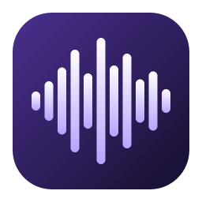
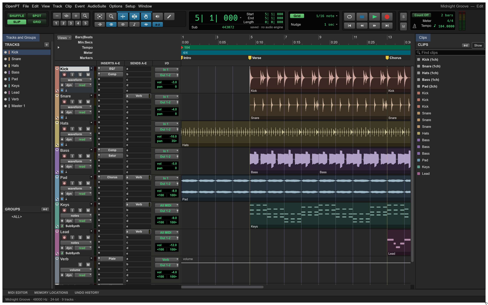
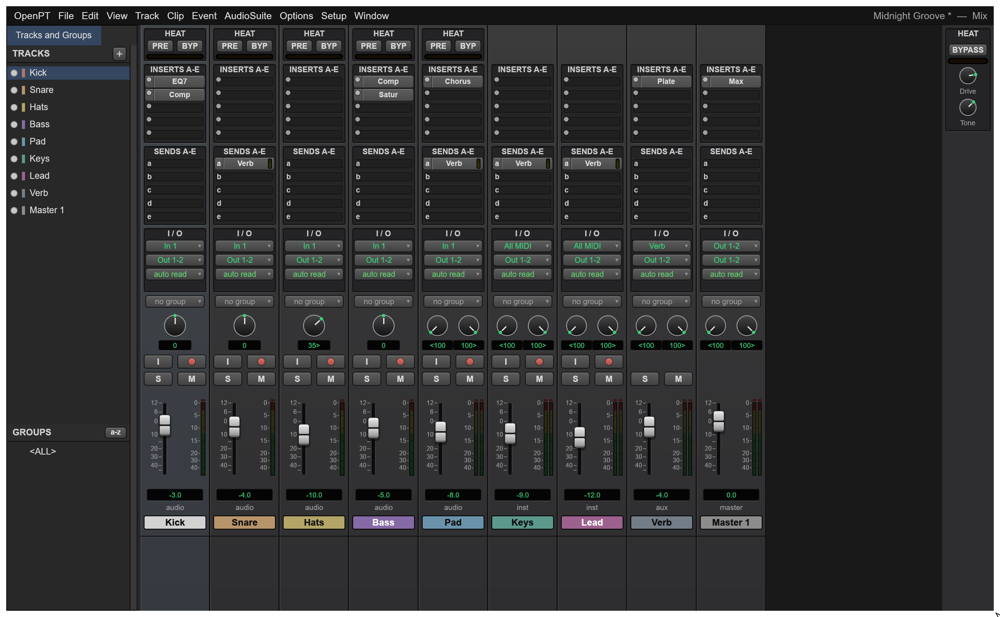
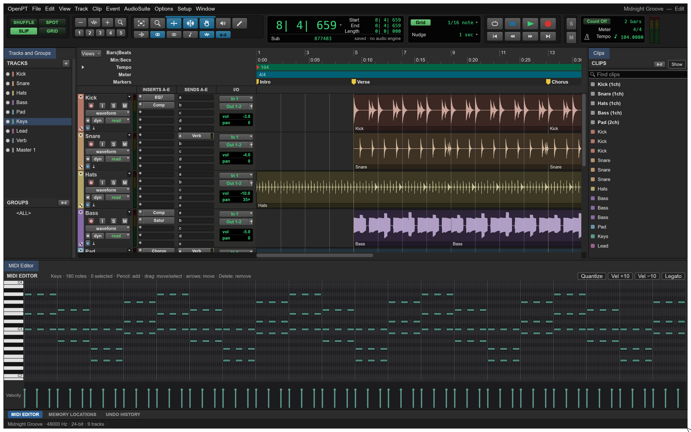
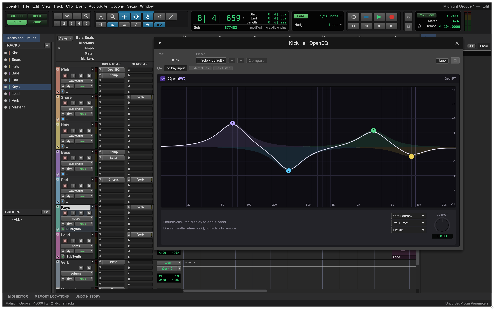

<p align="center">
  
</p>

<h1 align="center">OpenPT</h1>

<p align="center">
  <b>Record, edit and mix the Pro Tools way, in an open-source DAW written in Rust.</b><br>
  Edit and Mix windows, inserts A–J, VCAs, playlists, automation, Dolby Atmos and your own VST3 plugins,<br>
  in a native app that opens <code>.ptx</code> sessions. Open source, offline, and yours.
</p>

<p align="center">
  
  
  
  
  
</p>

<br>

<p align="center">
  
  <br>
  <sub>The Edit window on the built-in demo session, whose audio and MIDI are synthesised in code.</sub>
</p>

<p align="center">
  <a href="#features">Features</a> ·
  <a href="#everything-in-the-box">Everything in the box</a> ·
  <a href="#built-to-be-scripted">Scripting</a> ·
  <a href="#under-the-hood">Under the hood</a> ·
  <a href="#download">Get started</a> ·
  <a href="#status">Status</a>
</p>

<br>

<table>
  <tr>
    <td width="25%" valign="top">
      <h3>🎛️ Familiar by design</h3>
      The windows, menus, modes and track layout are where your hands expect them. If you know Pro Tools, you already know your way around. In English or French.
    </td>
    <td width="25%" valign="top">
      <h3>🔌 Your plugins</h3>
      VST3 on Windows and macOS, Audio Units on macOS, with sidechain, ARA and delay compensation. A plugin that crashes during the scan is skipped, not fatal.
    </td>
    <td width="25%" valign="top">
      <h3>🗂️ Opens <code>.ptx</code></h3>
      Bring in tracks, clips, routing, sends, inserts, tempo, meters, markers, groups, folders and VCAs from a Pro Tools session.
    </td>
    <td width="25%" valign="top">
      <h3>🧩 Scriptable</h3>
      Every action is a command, so the same engine answers to the UI, the CLI, a JSON control channel and an MCP server.
    </td>
  </tr>
</table>

<br>

## Features

Every screenshot here is the real app, rendered offscreen through its control channel.

<table>
  <tr>
    <td width="50%" valign="top">
      
      <br>
      <sub>The Mix window, with the track saturation section at the top of the audio strips.</sub>
      <h3>A console you can trust</h3>
      Ten inserts and ten sends per track, multichannel or multi-mono, with busses, aux tracks, VCAs, groups and folders. Show only the strip sections you need.
      <br><br>
      Stepped per-track saturation adds colour before or after the inserts: odd harmonics on one side of the Drive control, a triode character on the other, and a Tone control to shape it.
    </td>
    <td width="50%" valign="top">
      
      <br>
      <sub>The docked MIDI Editor, with a piano roll and a velocity lane.</sub>
      <h3>MIDI that keeps up</h3>
      Record takes from your MIDI devices, draw and move notes, quantize, and edit velocities in the same window as your audio.
      <br><br>
      Audio to MIDI handles polyphonic, melodic and drum material, and MIDI Learn maps your controllers to the mix.
    </td>
  </tr>
  <tr>
    <td width="50%" valign="top">
      
      <br>
      <sub>OpenEQ on the kick, one of the bundled plugins with its own interface.</sub>
      <h3>Plugins in the box</h3>
      OpenEQ, OpenComp, OpenG, OpenDS, OpenL, OpenMB, OpenR, OpenEcho, OpenSat and OpenDRT, each with its own interface, alongside a synth, a drum synth and a sampler.
      <br><br>
      Presets, Compare, automation and key input live in the same plugin window, for bundled and third-party plugins alike.
    </td>
    <td width="50%" valign="top">
      <h3>Immersive when you need it</h3>
      Formats from stereo to 9.1.6 and Ambisonics, with a surround panner and fold-down.
      <br><br>
      Dolby Atmos beds and objects with automated 3D position, monitoring in binaural, 5.1 or stereo with trims, and ADM BWF export. Binaural distance can be set per object and bed channel, with SOFA profiles.
      <h3>Edit at the speed of the session</h3>
      Shuffle, Spot, Slip and Grid, playlists, clip gain, fades, clip groups, Elastic warping, TCE, conform to tempo, Beat Detective and Identify Beat.
      <br><br>
      Automation in Read, Touch, Latch, Write and Trim, plus a video track with timecode rulers for post work.
    </td>
  </tr>
</table>

<br>

## Everything in the box

<table>
  <tr>
    <td width="33%" valign="top">
      <h4>🎚️ Mixing</h4>
      Inserts A–J · Sends A–J · Busses and aux tracks · VCAs · Mix and edit groups · Folder tracks · Multi-mono inserts · Plugin delay compensation · Sidechain · Automation modes · HUI and Mackie Control · MIDI Learn · Main output on any interface channels
    </td>
    <td width="33%" valign="top">
      <h4>🎼 Audio and MIDI</h4>
      Take recording lined up with the driver latency · Playlists · Clip gain · Fades · Clip groups · Elastic warping · Beat Detective · Audio to MIDI · Piano roll · Virtual keyboard · Quantize · Templates and track presets · Memory locations · AudioSuite · MTC, MIDI Beat Clock and LTC, generated and chased
    </td>
    <td width="33%" valign="top">
      <h4>🗂️ Formats</h4>
      <b>Reads and writes:</b> WAV, BWF, RF64, AIFF, FLAC. <b>Writes:</b> MP3, ADM BWF. <b>Reads:</b> MP3, AAC/M4A, ALAC, Ogg Vorbis, CAF, MIDI files, <code>.ptx</code> sessions, H.264, ProRes and MJPEG video. <b>Native:</b> <code>.openpt</code> sessions with an <code>Audio Files</code> folder.
    </td>
  </tr>
</table>

<br>

## Built to be scripted

Every menu item and button runs a command from one registry. The UI, the CLI, the JSON control channel and the MCP server all call the same commands, so anything you can click, a script can do too.

```sh
# Headless: load the demo, change the mix, bounce it
openpt-cli run --demo --cmd 'mix.volume={"track":"Kick","db":-6}' --bounce out.wav

# List every command
openpt-cli commands

# Drive the running app over the control channel
openpt --control 7801
openpt-cli app --port 7801 transport.play

# Serve the same commands over MCP
openpt-cli mcp --connect 7801
```

See [`docs/control-protocol.md`](docs/control-protocol.md) and [`docs/mcp.md`](docs/mcp.md).

## Under the hood

- **Engine first:** a plain-data session document and a command engine, with a thin egui interface on top.
- **Safe by default:** `unsafe` is forbidden everywhere except the isolated plugin-hosting crates.
- **Sources from disk:** audio plays from a memory-mapped decoded cache with read-ahead, and takes record straight to disk.
- **Plugin scanning in child processes:** a third-party plugin that crashes or hangs while loading can't take the app down.
- **Tested:** more than 1,300 tests across the workspace.

| Crate | Role |
|---|---|
| `time`, `audio-io`, `midi`, `video` | timebases and tempo maps; audio files and peaks; MIDI files; video |
| `dsp` | built-in plugins, offline processing, meters |
| `model` | the session document |
| `mix` | the mix engine (realtime and bounce), multi-mono inserts |
| `engine`, `playback` | commands, undo, editing, import/export; audio and MIDI devices |
| `ptx` | reads Pro Tools sessions for interoperability |
| `transcribe` | audio to MIDI |
| `vst3-host`, `au-host` | plugin hosting (the only crates allowed `unsafe`) |
| `automation` | MCP server and control channel |
| `ui-kit`, `ui-egui` | interface |

## Download

Installers for Windows x64 and Apple Silicon Macs are on the [releases page](https://github.com/aurelienjsureau/openpt/releases/latest):

- [Windows installer](https://github.com/aurelienjsureau/openpt/releases/latest/download/OpenPT-0.8.0-Setup.exe)
- [macOS disk image](https://github.com/aurelienjsureau/openpt/releases/latest/download/OpenPT-0.8.0-macos-arm64.dmg)

They are not signed by a recognised publisher, so Windows SmartScreen and macOS Gatekeeper will warn on first launch.

## Build from source

```sh
git clone https://github.com/aurelienjsureau/openpt
cd openpt
cargo run --release -p openpt -- --demo    # the desktop app, on the demo session
```

ASIO on Windows needs libclang, with `LIBCLANG_PATH` pointing to the folder holding `libclang.dll`:

```sh
cargo build --release -p openpt --features asio
```

Run the tests with `OPENPT_NO_SYSTEM_PLUGINS`, which keeps them away from the plugins installed on your machine:

```sh
OPENPT_NO_SYSTEM_PLUGINS=1 cargo test --workspace --exclude openpt-web
```

## Status

OpenPT 0.8 is stable and ready for real sessions. Not there yet: AAF/OMF interchange, saving back to `.ptx`, EUCON, and interface languages other than English and French. Plugins run in-process. Windows is the most exercised platform; the macOS build is Apple Silicon only and unsigned, and Linux has seen little testing.

Bug reports and feature requests are welcome in the [issues](https://github.com/aurelienjsureau/openpt/issues).

## Contributing

Fixes and new features are welcome: see [`CONTRIBUTING.md`](CONTRIBUTING.md).

## License

MIT OR Apache-2.0. See [`NOTICE`](NOTICE), [`LICENSE-MIT`](LICENSE-MIT), [`LICENSE-APACHE`](LICENSE-APACHE) and [`ATTRIBUTION.md`](ATTRIBUTION.md).

Pro Tools and Dolby Atmos are trademarks of their respective owners. OpenPT is not affiliated with or endorsed by Avid or Dolby.
